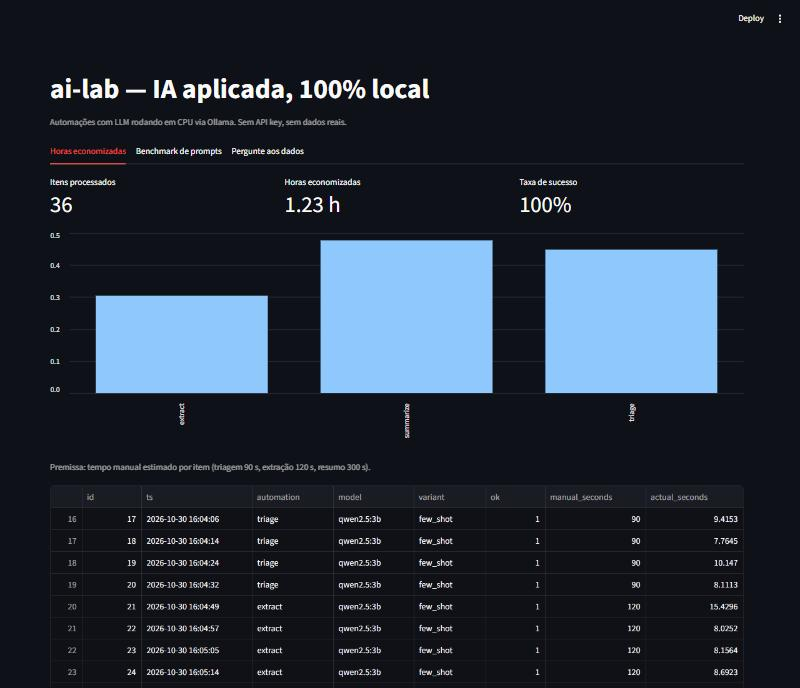
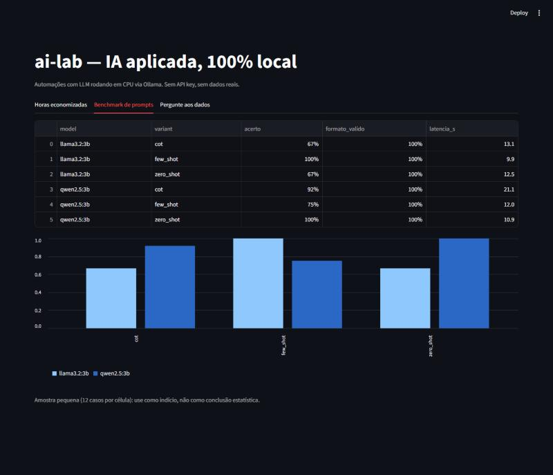
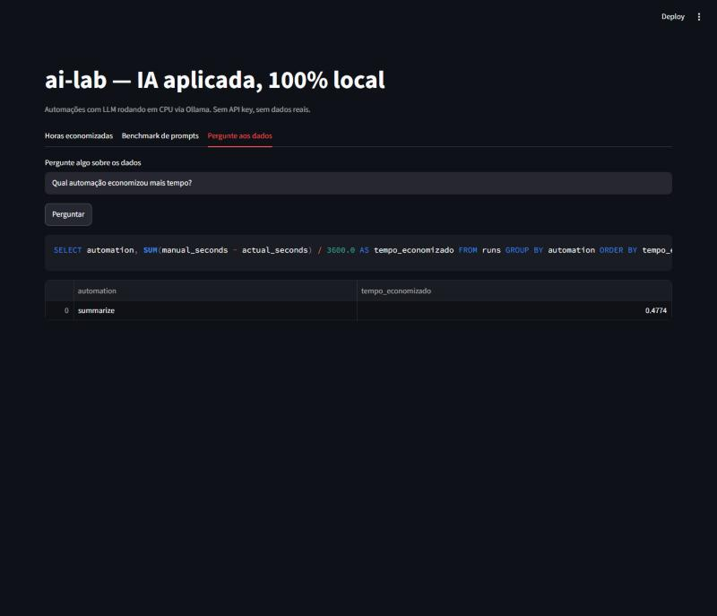

# ai-lab — IA aplicada, 100% local

Prompts estruturados, benchmark de LLMs, automações com horas economizadas medidas e um dashboard onde você pergunta aos dados em linguagem natural. **Sem API key, sem nuvem, sem dados reais**: tudo roda em CPU via [Ollama](https://ollama.com).



## Resultados (rodada real, CPU, modelo de 3B)

| Automação | Itens | Sucesso | Tempo médio por item | Horas economizadas* |
|---|---|---|---|---|
| Triagem de tickets (categoria, urgência, resposta) | 20 | 100% | 9,3 s | 0,45 h |
| Extração de dados de faturas | 10 | 100% | 10,4 s | 0,30 h |
| Resumo de documentos (bullets + ações) | 6 | 100% | 13,6 s | 0,48 h |
| **Total** | **36** | **100%** | | **1,23 h** |

\* **Premissa declarada:** tempo manual estimado por item de 90 s (triagem), 120 s (extração) e 300 s (resumo). As horas economizadas são `tempo manual estimado − tempo real medido`. Os tempos manuais são estimativas, não medições; ajuste em `ailab/automations.py` com os valores do seu processo.

### Benchmark de prompts (triagem, 12 casos por célula)

| Modelo | zero-shot | few-shot | chain-of-thought |
|---|---|---|---|
| `qwen2.5:3b` | **100%** | 75% | 92% |
| `llama3.2:3b` | 67% | **100%** | 67% |

Formato JSON válido: 100% em todas as combinações (graças à validação com retry). Latência média de 9,9 s a 21,1 s por chamada; chain-of-thought é a variante mais lenta.

**Leitura honesta:** com 12 casos por célula, uma única resposta muda 8 pontos percentuais. O resultado indica que **a melhor técnica de prompt depende do modelo** (few-shot ajudou o Llama e atrapalhou o Qwen), não que um modelo seja melhor que o outro.



## Como funciona

```
texto → template YAML → LLM (Ollama) → JSON validado (Pydantic, retry) → SQLite → dashboard
```

- `ailab/llm.py`: única porta de entrada para o modelo. Trocar de provedor é mexer em um arquivo.
- `ailab/prompts.py` + `ailab/templates/*.yaml`: prompts estruturados (papel, instruções, formato de saída, exemplos) em três variantes (zero-shot, few-shot, chain-of-thought).
- `ailab/structured.py`: valida a saída com Pydantic. Se vier inválida, reenvia o prompt incluindo o erro de validação (até 2 retries).
- `ailab/automations.py`: três automações; cada item processado registra tempo manual estimado vs. tempo real.
- `ailab/bench.py`: compara variantes de prompt e modelos em acerto, formato válido e latência.
- `ailab/askdata.py` + `ailab/sqlguard.py`: o LLM escreve SQL, e só roda se for um único `SELECT`, em conexão SQLite `mode=ro`.
- `dashboard/app.py`: Streamlit com as três visões.



## Decisões técnicas

- **Camada LLM isolada:** testes mockam o LLM (23 testes rápidos, sem GPU nem rede); só o smoke test usa o Ollama.
- **Retry com feedback:** reenviar o erro de validação ao modelo recuperou formatos inválidos sem custo de engenharia no prompt.
- **SQL gerado em defesa dupla:** validação textual (só `SELECT`, sem `;` extra, sem DDL/DML) **e** conexão somente-leitura.
- **Few-shot no "pergunte aos dados":** a primeira versão do prompt (só o schema) fazia o modelo de 3B calcular "tempo economizado" errado. Definir a métrica e dar dois exemplos corrigiu.
- **Dados sintéticos e determinísticos** (`scripts/gen_synthetic.py`, seed 42): reprodutível e sem risco de privacidade.

## Limitações

- Modelos de 3B em CPU são lentos (~10 s por item) e erram em consultas SQL mais complexas.
- Benchmark com amostra pequena; é um indício, não prova estatística.
- Dados sintéticos são mais limpos que os do mundo real.

## Rodando

```bash
winget install Ollama.Ollama
ollama pull qwen2.5:3b && ollama pull llama3.2:3b
python -m venv .venv && .venv/Scripts/python -m pip install -r requirements.txt
.venv/Scripts/python scripts/gen_synthetic.py
.venv/Scripts/python -m ailab.cli automate triage --n 20
.venv/Scripts/python -m ailab.cli bench --n 12 --models qwen2.5:3b llama3.2:3b
.venv/Scripts/python -m streamlit run dashboard/app.py
.venv/Scripts/python -m pytest
```
